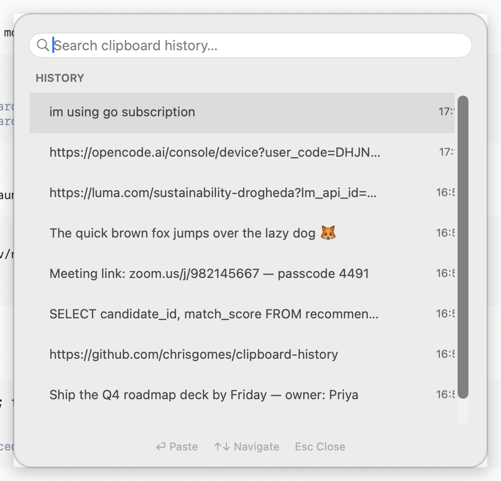

# LinkedIn Post — ClipboardHistory

**Image to attach:** `screenshot.png` (this folder)

---

## Post text

I kept losing things I copied 10 minutes ago. So I built the clipboard manager Apple should have shipped. 🍎

**ClipboardHistory** — Win+V, but for your Mac. Free for lifetime.



**What it does:**
📋 Hit **⌥V** anywhere → searchable history of everything you've copied
🖼️ Text **and** images (screenshots, copied pictures) with thumbnails
⏎ Pick an item → it **auto-pastes** into the app you were already using
🔒 Password-manager copies are **included** — flagged with 🔒 so you always know, encrypted at rest, auto-deleted after 7 days
🔍 Live search — find that link from yesterday in 2 seconds

**Why I built it instead of buying one:**
❌ Every alternative wants a subscription
❌ Most send your clipboard history to a cloud server
✅ This one is **100% local** — history index is AES-256-GCM encrypted, key stays in your macOS Keychain
✅ **$0 forever** — no subscriptions, no telemetry, no catch

**Install (2 commands):**

```sh
git clone <repo-url> && cd clipboard-history
./build.sh --install
```

That's it — it builds, installs to ~/Applications, and starts at login.
(First paste asks for Accessibility permission — one toggle in System Settings.)

**Use it:**

| Key | Action |
|---|---|
| ⌥V | Open / close history |
| ↑ ↓ | Navigate |
| ⏎ | Paste into frontmost app |
| Type | Live search |
| Esc | Close |

Built with plain Swift — no Xcode project, no dependencies, no cost.

What clipboard feature do you wish your OS had? 👇

#macOS #Swift #BuildInPublic #Productivity #OpenSource

---

## Posting checklist

- [ ] Attach `screenshot.png` as the image (first image, so it shows in feed)
- [ ] Replace `<repo-url>` if pushing to GitHub
- [ ] Post between 8–10 AM local time for best reach
- [ ] Reply to early comments within the first hour

## Optional shorter version (if char limit bites)

I built a free-for-lifetime Win+V for Mac. ⌥V → searchable clipboard history, auto-paste, images included, AES-256 encrypted on disk, 100% local. No subscription, no cloud, no telemetry. Install: `./build.sh --install`. Source in the comments 👇
